# TESTING
# Quizzes for CS Year 2

## Quiz 1
### Code
```.java
import java.util.Random;

public class RanNum{
  public String getNumber(){
    Random random = new Random();

    int result = random.nextInt(256);

    return String.valueOf(result);
  }
}
```
### Work
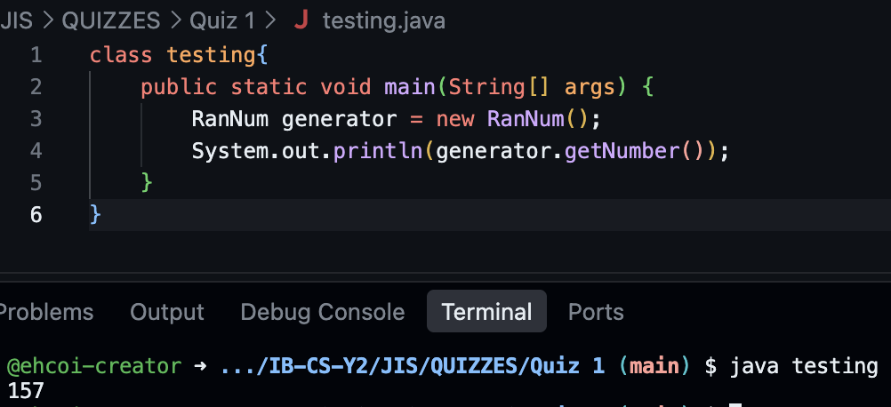

## Quiz 2
### Code
```.java
public class IPv4Gen{
    public String generate() {
        String result = "";

        RanNum ranNum = new RanNum();
        int number;

        for (int i = 0; i <= 3; i++) {
            number = Integer.parseInt(ranNum.getNumber());

            while (number == 256) {
                number = Integer.parseInt(ranNum.getNumber());
            }

            result += number + ".";
        }

        return result.substring(0, result.length() - 1);
    }
}
```
### Work
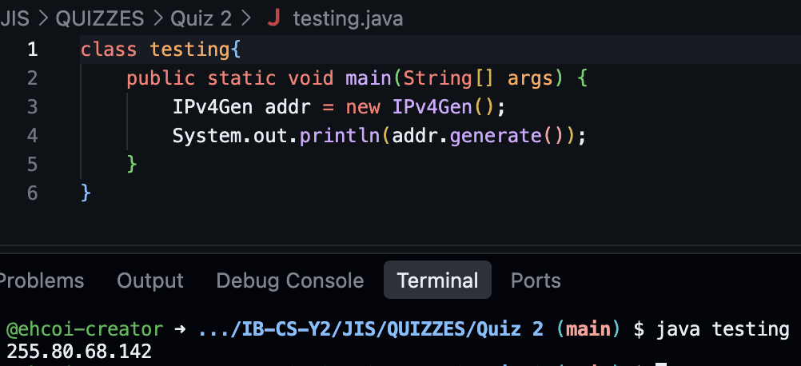

## Quiz 3
### Code
```.java
public class checker{

    boolean test = false;

    public checker(String add) {
        String[] parts = add.split("\\.");

        test = parts.length == 4;

        if (test) {
            for (int i = 0; i < 4; i++){
                int number = castInteger(parts[i]);

                if (0 <= number && number <= 255) {
                } else {
                    test = false;
                }
            }
        }
    }

    private int castInteger(String S) {
        try {
            return Integer.parseInt(S);
        } catch (NumberFormatException e) {
            return -1;
        }
    }
}
```
### Work
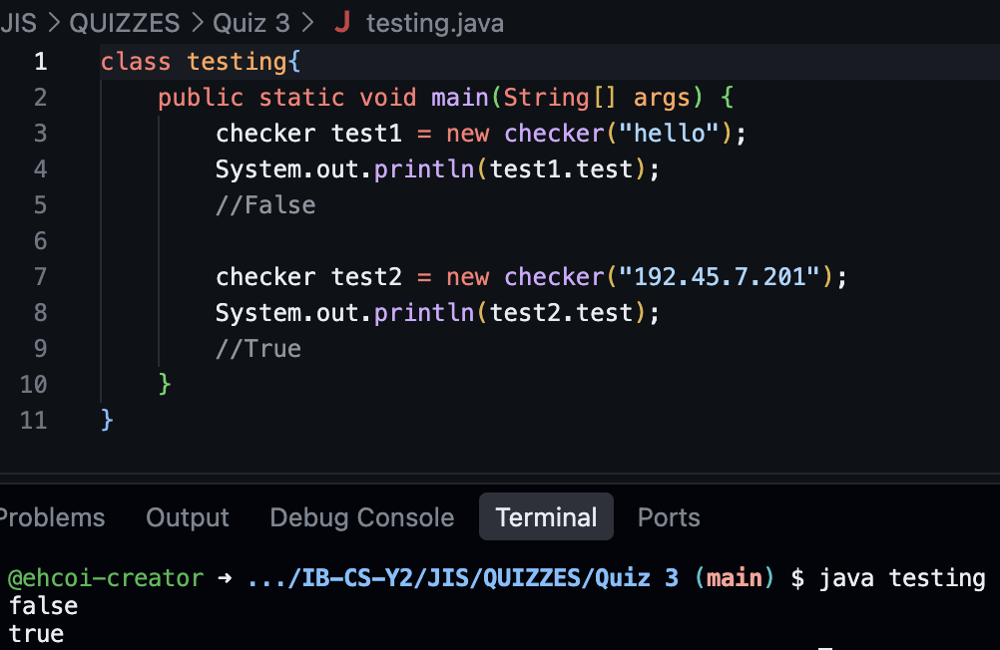

## Quiz 4
### Code
```.java
import java.util.Arrays;
import java.util.ArrayList;

public class porter{
    private String service;
    private String ip;

    private ArrayList<String> services =
        new ArrayList<>(Arrays.asList("http", "https", "playstation", "ssh", "ftp", "mysql"));
    
    private ArrayList<Integer> ports = new ArrayList<>(Arrays.asList(80, 443, 3479, 22, 20, 3306));

    public porter (String serviceInput, String ipInput) {
        service = serviceInput;
        ip = ipInput;
    }

    public String build(){
        int index = services.indexOf(service);

        if (index == -1) {
            return "service not on record table. Use register() to add a new service:port pair";
        }

        return ip + ":" + ports.get(index);
    }
}
```
### Work:
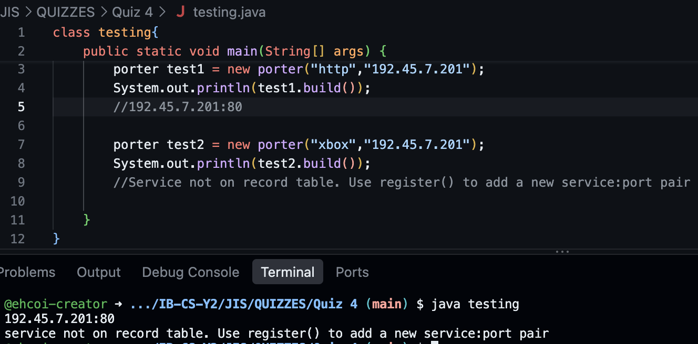

## Quiz 5
### Code
```.java
import java.util.Arrays;
import java.util.ArrayList;

public class dns {
    private String hostname;

    protected ArrayList<String> hostnames = new ArrayList<>(Arrays.asList("localhost", "google.com", "example.com"));
    protected ArrayList<String> ips = new ArrayList<>(Arrays.asList("127.0.0.1", "142.250.72.14", "7.7.7.7"));

    public dns(String hostnameInput) {
        hostname = hostnameInput;
    }

    public String lookup() {
        int index = hostnames.indexOf(hostname);

        if (index == -1) {
            return "service not on record table. Use register() to add a new service:IP pair";
        }

        return ips.get(index);
    }
}
```
### Work
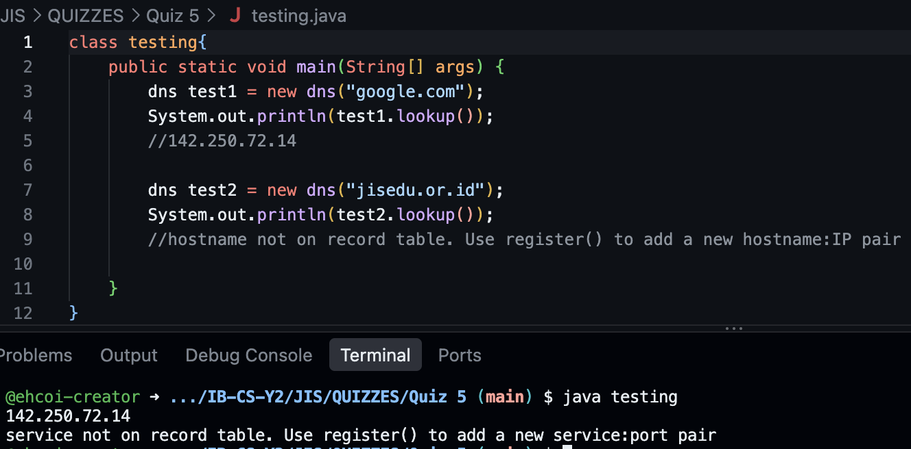

## Quiz 6
### Code
```.java
import java.util.Arrays;
import java.util.ArrayList;

public class filter extends dns {
    private String ip;
    private String hostname;
    private int index;

    private ArrayList<String> whitelist = new ArrayList<>(Arrays.asList("127.0.0.1", "142.250.72.14", "example.com"));

    public filter(String input) {
        super(input);

        index = hostnames.indexOf(input);
 
        if (index != -1) {
            hostname = input;
            ip = ips.get(index);
        } else {
            index = ips.indexOf(input);
            if (index != -1) {
                ip = input;
                hostname = hostnames.get(index);
            }
        }
    }

    public String check() {
        if (index != -1 && whitelist.contains(ip) || whitelist.contains(hostname)) {
            return "accepted ip:" + ip + " hostname:" + hostname;
        }

        return "rejected";
    }

}
```
### Work
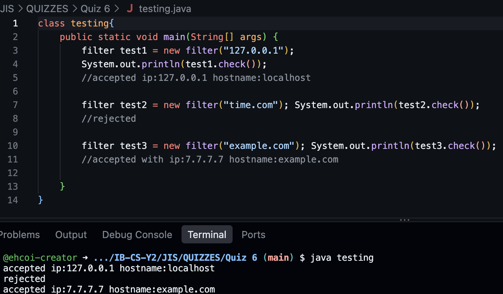


## Quiz 8
### Code
```.java
import java.util.ArrayList;
import java.util.Arrays;
 
public class NAT {
    ArrayList<String> sourceIps = new ArrayList<>(Arrays.asList("192.168.1.10", "192.168.1.11", "192.168.1.12"));
    ArrayList<Integer> sourcePorts = new ArrayList<>(Arrays.asList(4500, 5100, 5100));
 
    ArrayList<String> transIps = new ArrayList<>(Arrays.asList("203.0.113.55", "203.0.113.55", "203.0.113.55"));
    ArrayList<Integer> transPorts = new ArrayList<>(Arrays.asList(10001, 10002, 10003));

    int count;

    public String get_new_trans(String ip, int port) {
        for (int i = 0; i < sourceIps.size(); i++) {
            if (sourceIps.get(i).equals(ip) && sourcePorts.get(i) == port) {
                return transIps.get(i) + ":" + transPorts.get(i);
            }
        }

        String newIp = "203.0.113.55";
        int newPort = transPorts.get(transPorts.size() - 1) + 1;
 
        sourceIps.add(ip);
        sourcePorts.add(port);
        transIps.add(newIp);
        transPorts.add(newPort);
 
        return newIp + ":" + newPort;
    }
}
```
### Work
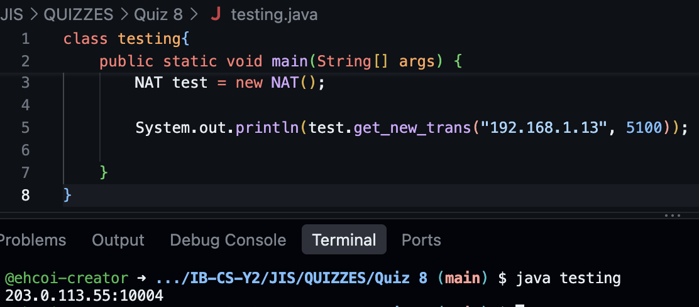

## Quiz 9
### Code
```.java
import java.util.Arrays;


public class ArrayAvg{
    private int[][] array; 

    public ArrayAvg(int[][] input){
        array = input;
    }

    public String getAverage(){
        int row = array[0].length;
        int col = array.length;

        String result = "Row Average: ";
        int sum = 0;

        for (int i=0; i<col; i++){
            for (int j = 0; j < row; j++) {
                sum += array[i][j];
            }

            result += sum/row + " ";
            sum = 0;
        }

        result += "\nColumn Average: ";
        
        for (int j = 0; j < col; j++){
            for (int i=0; i< row; i++) {
                sum += array[i][j];
            }
            
            result += sum/col + " ";
            sum = 0;
        }

        return result;
    }
}
```
### Work
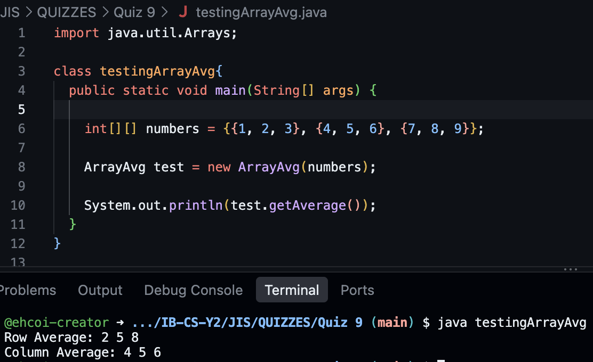

## Quiz 10
### Code
```.java
import java.util.Arrays;

public class Matrix{
    public int[][] matrix;

    public Matrix(int[][] input) {
        matrix = input;
    }

    public int[][] scale(int scale){
        int row = matrix.length;
        int col = matrix[0].length;

        int[][] result = new int[row][col];

        for (int i = 0; i < row; i++) {
            for (int j=0; j<col; j++) {
                result[i][j] = matrix[i][j]*scale;
            }
        }

        return result;
    }

    public void show(int[][] matrix){
        for (int i = 0; i < matrix[0].length; i++) {
            System.out.println(Arrays.toString(matrix[i]));
        }
    }
}
```

### Work
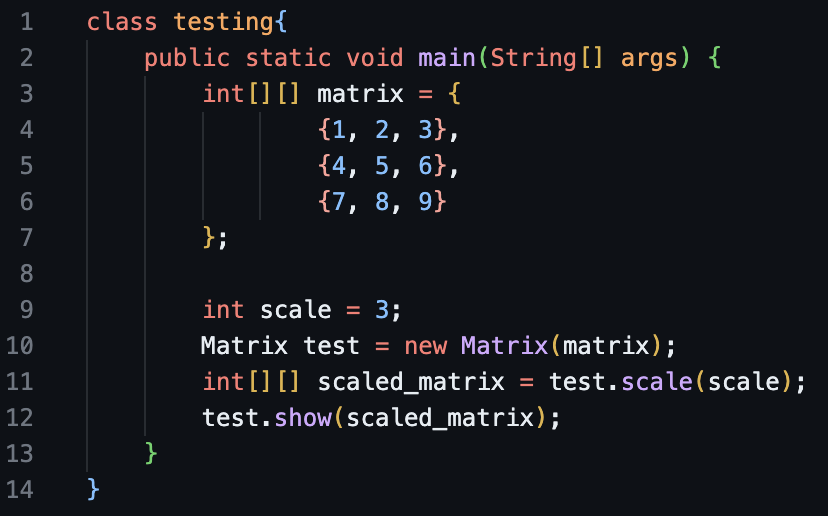
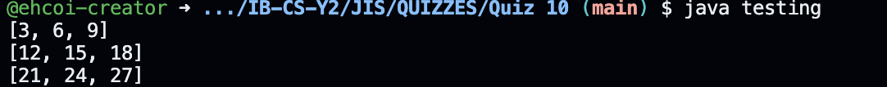

## Quiz 11
### Code
```.java
import java.util.Arrays;

public class Matrix{
    public int[][] matrix;
    public int size;

    public Matrix(int size) {
        matrix = new int[size][size];
        this.size = size;
    }

    public int[][] identity() {
        int[][] result = new int[size][size];

        for (int i = 0; i < size; i++){
            result[i][i] = 1;
        }

        return result;
    }

    public void show(int[][] matrix){
        for (int i = 0; i < matrix[0].length; i++) {
            System.out.println(Arrays.toString(matrix[i]));
        }
    }
}
```

### work
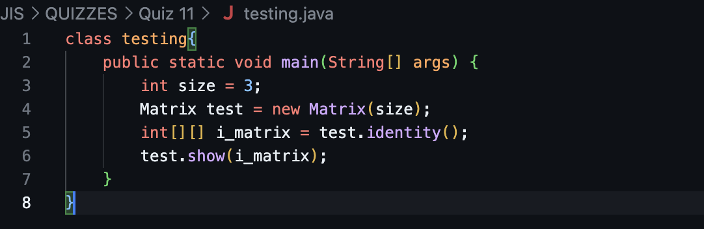
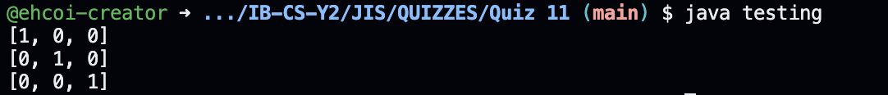

## Quiz 12
### Code
```.java
import java.util.Arrays;

public class Matrix{
    public int[][] matrix;
    public int size;

    public Matrix(int size) {
        matrix = new int[size][size];
        this.size = size;
    }

    public Matrix(int[][] userMat) {
        matrix = userMat;
    }

    public int[][] identity() {
        int[][] result = new int[size][size];

        for (int i = 0; i < size; i++){
            result[i][i] = 1;
        }

        return result;
    }

    public void show(int[][] matrix){
        for (int i = 0; i < matrix[0].length; i++) {
            System.out.println(Arrays.toString(matrix[i]));
        }
    }

    public void show(int[] array){
        System.out.println(Arrays.toString(array));
    }

    public int[] vectorize() {
        int row = matrix.length;
        int col = matrix[0].length;

        int[] result = new int[row*col];

        int index = 0;

        for (int i = 0; i<row; i++) {
            for (int j = 0; j < col; j++){
                result[index] = matrix[i][j];

                index++;
            }
        }

        return result;
    }
}
```

### Word
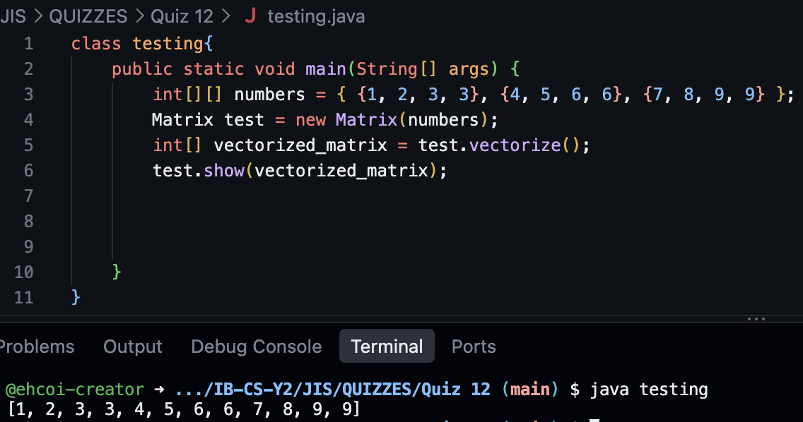

## Quiz 13
### Code
```.java
import java.util.Arrays;

public class Matrix{
    public int[][] matrix;
    public int size;
    public int[] numbers;

    public Matrix(int size) {
        matrix = new int[size][size];
        this.size = size;
    }

    public Matrix(int[][] userMat) {
        matrix = userMat;
    }

    public Matrix(int[] input) {
        numbers = input;
    }

    public int[][] identity() {
        int[][] result = new int[size][size];

        for (int i = 0; i < size; i++){
            result[i][i] = 1;
        }

        return result;
    }

    public void show(int[][] matrix){
        for (int i = 0; i < matrix[0].length; i++) {
            System.out.println(Arrays.toString(matrix[i]));
        }
    }

    public void show(int[] array){
        System.out.println(Arrays.toString(array));
    }

    public int[] vectorize() {
        int row = matrix.length;
        int col = matrix[0].length;

        int[] result = new int[row*col];

        int index = 0;

        for (int i = 0; i<row; i++) {
            for (int j = 0; j < col; j++){
                result[index] = matrix[i][j];

                index++;
            }
        }

        return result;
    }

    public int[][] toMatrix(){
        int numSize = (int) Math.ceil(Math.sqrt(numbers.length));
        
        int[][] result = new int[numSize][numSize];

        for (int i = 0; i < numbers.length; i++) {
            result[i/numSize][i%numSize] = numbers[i];
        }

        return result;
    }
}
```
### Work
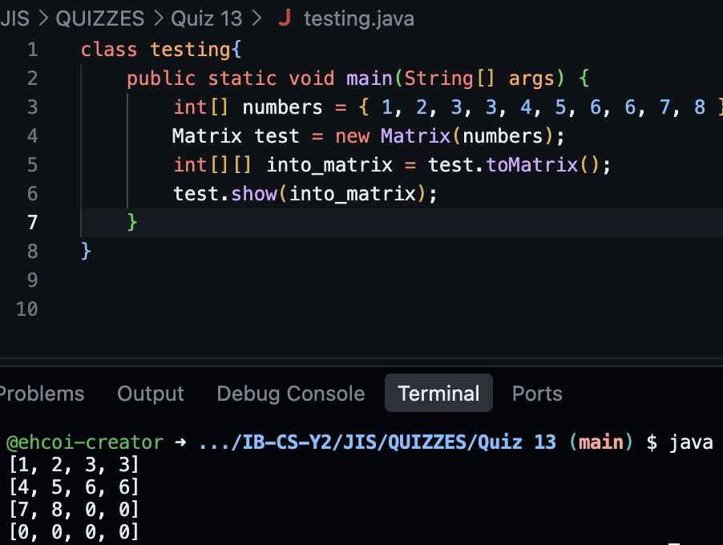

## Quiz 14
### Code
```.java
import java.util.Arrays;

public class Matrix{
    public int[][] matrix;
    public int size;
    public int[] numbers;

    public Matrix(int size) {
        matrix = new int[size][size];
        this.size = size;
    }

    public Matrix(int[][] userMat) {
        matrix = userMat;
    }

    public Matrix(int[] input) {
        numbers = input;
    }

    public Matrix() {
    }

    public int[][] identity() {
        int[][] result = new int[size][size];

        for (int i = 0; i < size; i++){
            result[i][i] = 1;
        }

        return result;
    }

    public void show(int[][] matrix){
        for (int i = 0; i < matrix[0].length; i++) {
            System.out.println(Arrays.toString(matrix[i]));
        }
    }

    public void show(int[] array){
        System.out.println(Arrays.toString(array));
    }

    public int[] vectorize() {
        int row = matrix.length;
        int col = matrix[0].length;

        int[] result = new int[row*col];

        int index = 0;

        for (int i = 0; i<row; i++) {
            for (int j = 0; j < col; j++){
                result[index] = matrix[i][j];

                index++;
            }
        }

        return result;
    }

    public int[][] toMatrix(){
        int numSize = (int) Math.ceil(Math.sqrt(numbers.length));
        
        int[][] result = new int[numSize][numSize];

        for (int i = 0; i < numbers.length; i++) {
            result[i/numSize][i%numSize] = numbers[i];
        }

        return result;
    }

    public int[][] diagonal(int size){
        int[][] result = new int[size][size];

        for (int i = 0; i < size; i++) {
            result[i][i] = i+1;
        }

        return result;
    }
}
```
### Work
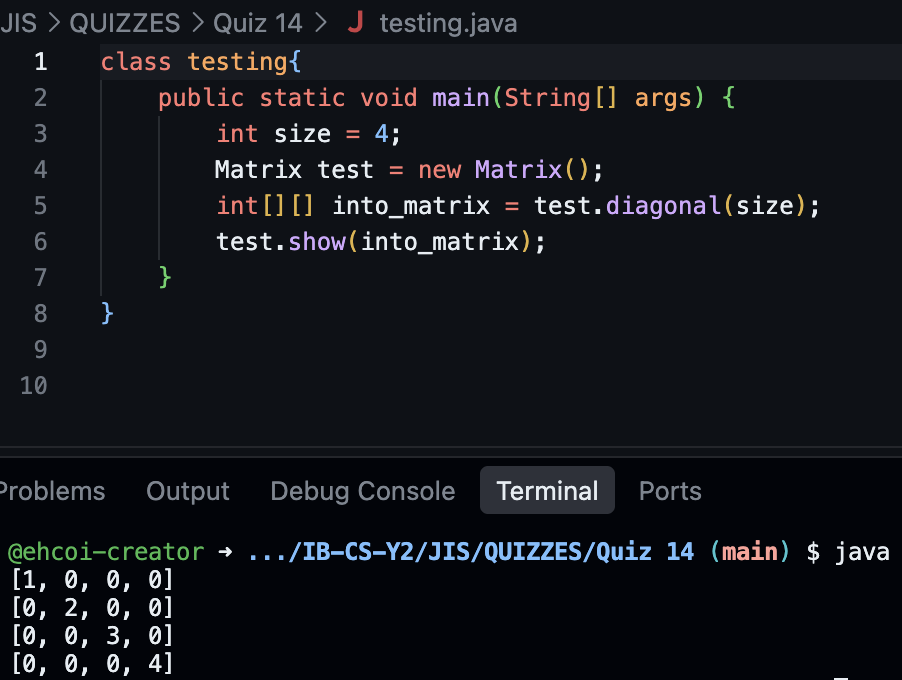


## Quiz 15
### Code
```.java
class ADC{
    public static void main(String[] args) {
        
        double analogSample = 2.35;
        double error = calculateADCError(analogSample);

        System.out.println("ADC Error: " + error + " V");


    }

    public static double calculateADCError(double analogSample){
        int range = 5;
        int resolution = 6;
        double stepSize = range/Math.pow(2, resolution);

        double appValue = Math.floor(analogSample/stepSize)*stepSize;

        return Math.round(Math.abs(analogSample-appValue)*100000.0)/100000.0;

        //rounding code source: https://mkyong.com/java/how-to-round-double-float-value-to-2-decimal-points-in-java/
    }
}
```
### Work
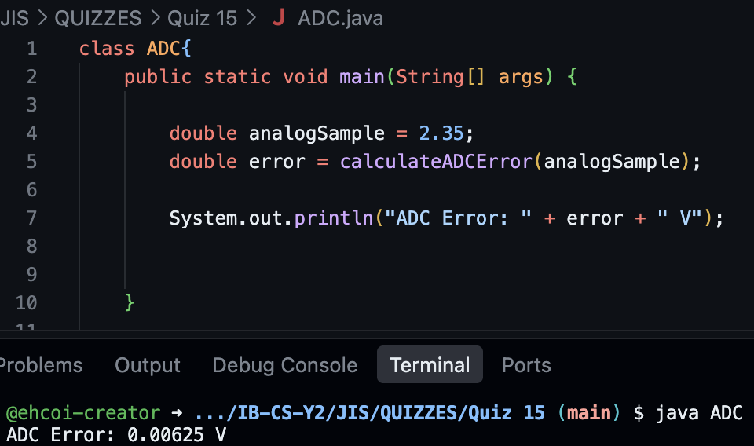


## Quiz 16
### Code
```.java
import java.util.Arrays;

class ADC{
    public static void main(String[] args) {
        double[] readings = {2.0, 1.5, 0.0, 2.02, 4.0, 5.0};
        int result = calculateResolution(0.0, 5.0, readings);
        System.out.println("Required ADC resolution: " + result + " bits");
    }

    public static int calculateResolution(
        double minVolt, double maxVolt, double[] readings
    ){
        Arrays.sort(readings);

        double minDiff = readings[1] - readings[0];

        for (int i = 2; i < readings.length; i++){
            double tempDiff = readings[i] - readings[i-1];

            if (tempDiff < minDiff){
                minDiff = tempDiff;
            }
        }

        double range = maxVolt - minVolt;

        int bit = 0;

        while (range/Math.pow(2,bit) > minDiff){
            bit++;
        }

        return (int) bit;
    }
}
```
### Work
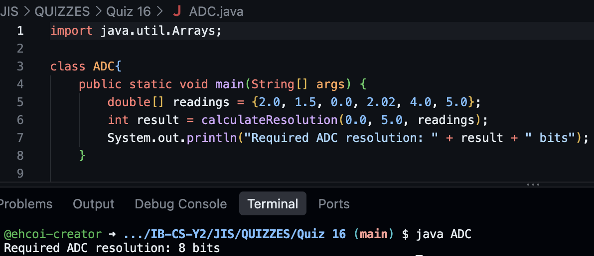